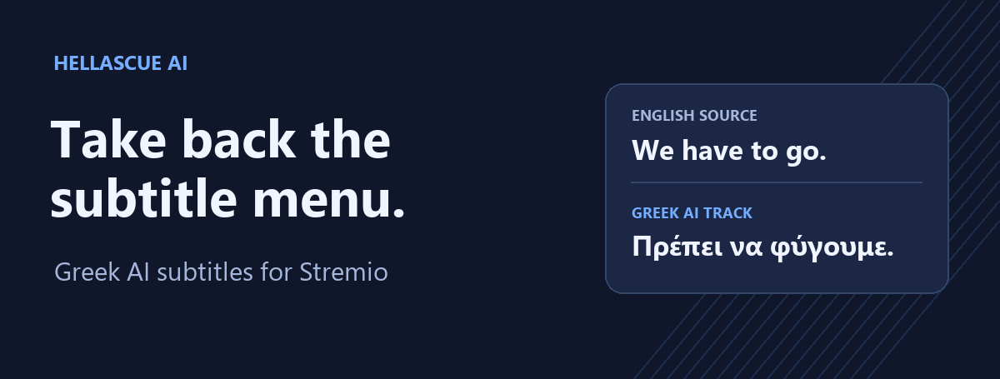
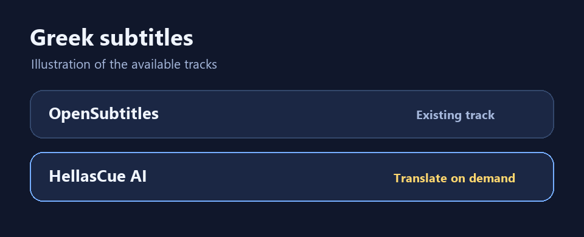

> HellasCue AI is now [PolyCue AI](https://github.com/jfle/aio-streams-subtitles-greek/tree/polycue-ai), with built-in OpenSubtitles v3 and multilingual AI translation.

# HellasCue AI

**Bad Greek subtitles? Switch tracks. Missing Greek subtitles? Generate them.**

HellasCue AI is a standalone Stremio addon that turns English subtitle files into Greek tracks you can pick from the subtitle menu. It checks the source against the release, looks for timing problems and gives you an AI backup when the existing Greek track lets you down.

[**Install HellasCue AI →**](INSTALL.md) · [**Get the installer build →**](https://github.com/jfle/aio-streams-subtitles-greek/actions/workflows/ci.yml?query=branch%3Ahellascue-ai)

## Take control of what you watch

- **Keep the Greek tracks you already have.** When a higher-priority provider offers Greek, HellasCue puts an AI backup within reach. Translation begins when the player loads that track.
- **Start with the right English file.** Release and file-hash matching help identify the right source. Timing analysis can correct supported frame-rate and offset issues.
- **Choose your own AI.** Use local Llama-Krikri where available, with an optional cloud API provider when local inference is unavailable. Successful local requests use no cloud quota.
- **Keep finished translations ready.** The server caches completed subtitle files so rewatches can skip generation.

## Quick start

1. Start the [standalone service](INSTALL.md) on Linux or run it with Docker Compose.
2. Open the printed **/configure** page. Choose a local model or a cloud API provider and test it.
3. Generate a private install link and open it in Stremio. When you watch, look for the AI choice under **Greek**.

An English subtitle file from a configured source is required. AI translation quality and timing depend on that source and your model. Greek is the default and other target languages are available.

### Self-hosting and usage costs

This build is distributed under the [MIT License](LICENSE). You provide the host and choose the model. Your cloud provider may charge for usage. The self-hosted build has no checkout or paid plan.

HellasCue AI is an independent addon for Stremio. AIOStreams deployment is available separately on the [AIOStreams standalone branch](https://github.com/jfle/aio-streams-subtitles-greek/tree/aiostreams-standalone).
