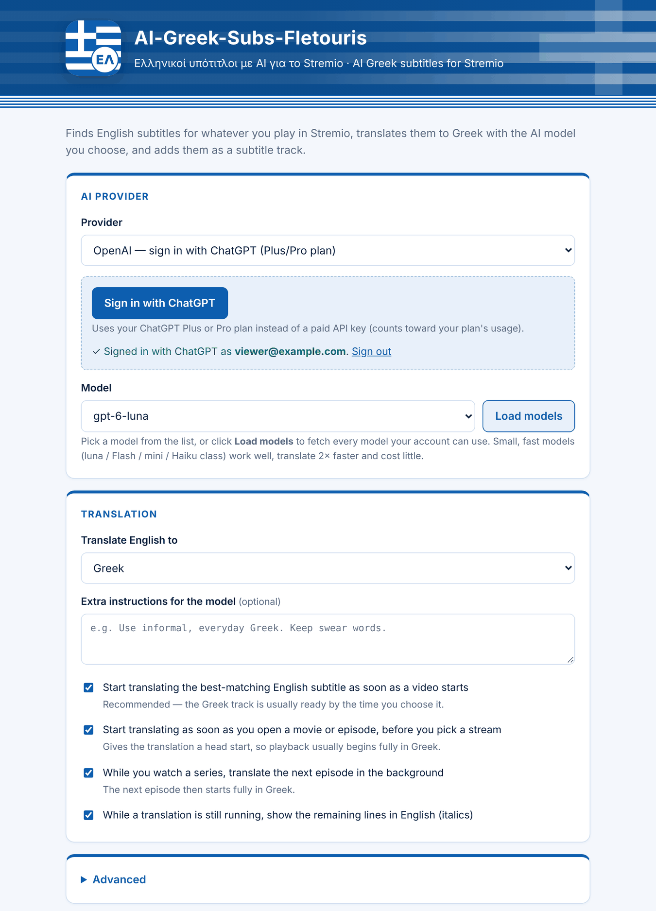
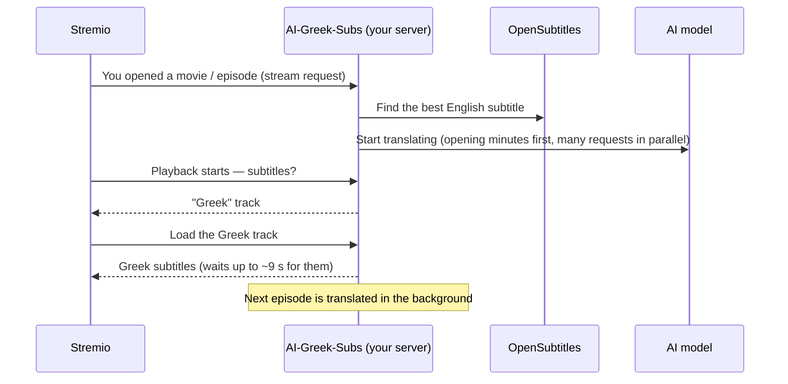

<div align="center">


# AI-Greek-Subs-Fletouris

**AI-translated Greek subtitles for Stremio** — any movie or episode that has English subtitles.

[](https://github.com/jfle/ai-greek-subs-fletouris/actions/workflows/ci.yml)
[](https://github.com/jfle/ai-greek-subs-fletouris/releases/latest)
[](LICENSE)


</div>

A self-hosted [Stremio](https://www.stremio.com) addon. It finds the English subtitles for whatever you are watching, translates them to Greek with the AI model you choose, and adds the result to the player as a **Greek** subtitle track. It runs on a Raspberry Pi, an Orange Pi, any Linux box, Docker, or your own PC.

Greek is the default; 17 other target languages are available on the configuration page.

<p align="center"></p>

## Features

- **Use the AI you already pay for — no API key needed:**
  - **Sign in with ChatGPT** (Plus / Pro plan)
  - **Sign in with Grok** (SuperGrok / X Premium plan)
  - **Sign in with OpenRouter** (one account for Claude, Gemini, Mistral, DeepSeek, Llama and hundreds more)
- **Or paste an API key** for OpenAI, Anthropic (Claude), Google Gemini, Mistral, DeepSeek, xAI, Groq, OpenRouter or Together AI.
- **Or run it 100% locally** with LM Studio, Ollama, vLLM or any OpenAI-compatible server (e.g. the Greek-tuned *Llama-Krikri-8B*).
- **Fast:** starts translating as soon as you *open* a title, sends many requests in parallel and does the opening minutes first. A 1,000-line episode takes about **1 minute** on a ChatGPT plan.
- **Binge-friendly:** while you watch an episode, the **next episode** is translated in the background, so it starts fully in Greek.
- **Smart matching:** asks your English subtitle sources (OpenSubtitles v3 by default) for the subtitle that matches your exact release (video hash and filename).
- **Cached:** finished translations are kept on disk for 30 days. Re-watching costs nothing.
- **Private:** your settings are encrypted inside your personal addon link; sign-ins stay on your server.
- **Zero npm dependencies**, one small Node.js process, a one-file installer for Debian / Ubuntu / Raspberry Pi OS / Armbian.

## Quick start

> Requirements in short: an always-on Linux machine on your home network (a Pi is perfect) and one AI account. Details: **[REQUIREMENTS.md](REQUIREMENTS.md)**.

**1. Install the server** (on the Pi / Linux box):

```bash
curl -fsSLO https://github.com/jfle/ai-greek-subs-fletouris/releases/latest/download/ai-greek-subs-fletouris-installer.sh
sudo bash ai-greek-subs-fletouris-installer.sh
```

It installs Node.js if needed, sets up a system service and **HTTPS on your home network** (Stremio requires HTTPS), then prints your address, e.g. `https://192-168-1-50.local-ip.sh/configure`.

**2. Configure:** open that address in a browser on your network, pick a provider, **sign in** (or paste a key), click **Load models**, pick a model and **Test translation**.

**3. Install in Stremio:** click **Generate install link → Install in Stremio**. Done — play anything and choose the **Greek** subtitle track.

Other ways to install (git clone, Docker, Windows/macOS, behind your own domain) and every option are in **[INSTALL.md](INSTALL.md)**.

## How it works



1. When you open a movie or episode, Stremio asks every addon for streams. This addon answers "no streams" but uses the request to start translating that title right away, while you are still picking a stream.
2. When playback starts, Stremio asks for subtitles. The addon finds the English subtitle that best matches your release and offers a **Greek** track pointing back to your server.
3. When the player loads the track, the server waits (Stremio allows about 10 s) until the file is finished — or at least the opening minutes are Greek — and sends it.
4. If the translation is still running, the untranslated lines show in English italics, tagged `[⏳ 42% · OFF/ON για ελληνικά]`. Stremio keeps the first copy it receives, so **turn subtitles OFF and back ON** to load the rest. With a cloud model this is rarely needed.
5. Finished translations are cached, and the next episode of a series is prepared while you watch.

> **Why does the addon fetch the English subtitle itself?** Stremio never tells an addon which subtitle you picked or what other addons returned. So the addon asks the same sources, ranked the same way, which almost always gives the same file. If you use another English subtitle addon, add its URL under **Advanced → English subtitle sources**.

## AI providers

| Provider | Sign-in | Notes |
|---|---|---|
| **OpenAI — ChatGPT plan** | ✅ Sign in with ChatGPT | Uses your Plus/Pro plan (24 parallel requests). "luna" models are the fastest. |
| **xAI (Grok)** | ✅ Sign in with Grok, or API key | Uses your SuperGrok / X Premium plan. xAI decides which accounts may use it this way; an API key always works. |
| **OpenRouter** | ✅ Sign in with OpenRouter, or API key | One account for almost every model. Optional spending limit at sign-in. |
| Anthropic (Claude) | API key · or one-click via OpenRouter sign-in | Anthropic doesn't allow Claude subscriptions in other apps. |
| Google Gemini | API key · or one-click via OpenRouter sign-in | Google offers no sign-in for other apps. |
| Mistral, DeepSeek, Groq, Together AI | API key · or one-click via OpenRouter sign-in | |
| OpenAI (API) | API key · or switch to Sign in with ChatGPT | |
| **Local** (LM Studio, Ollama, vLLM…) | — | Free and private. The addon asks LM Studio to switch "thinking" off. See [INSTALL.md → Local models](INSTALL.md#local-models-lm-studio--ollama). |

Small, fast models (luna / Flash / mini / Haiku / "non-reasoning" class) translate subtitles well. A feature film is roughly 1,000–1,500 lines ≈ 60–100k tokens — a few cents on pay-as-you-go models.

### Speed (measured)

| Setup | 1,010-line episode |
|---|---|
| ChatGPT plan, gpt-6.2-sol, 24 parallel | 56 s |
| ChatGPT plan, gpt-6-luna, 24 parallel | ≈ 30 s (estimated: luna answers about 2× faster) |
| Local LM Studio, Llama-Krikri-8B (RTX-class GPU), 4 parallel | ≈ 3.5 min |

## Watching tips

- Choose the subtitle track called **Greek** (the addon offers exactly one).
- If you see English lines tagged `[⏳ …]`, the translation is still running: **subtitles OFF → ON** loads everything translated so far.
- Series: the next episode is ready by the time you get to it.
- The first time you open a title the translation needs a moment; re-watching is instant (cached).

## Privacy & security

- Your configuration (provider, model, and any API key) is **encrypted (AES-256-GCM)** inside your personal addon link with a key that never leaves your server.
- Sign-ins (ChatGPT, Grok, OpenRouter) are stored **only on your server** in `data/credentials/` (owner-only permissions); the addon link carries an opaque reference.
- Anyone who has your full addon link can use your server — and therefore your AI account — so **don't share the link**. Share the project instead.
- Optional `CONFIG_PASSWORD` protects the configuration page.

See **[SECURITY.md](SECURITY.md)** for details and how to report a vulnerability.

## Troubleshooting

| Problem | Fix |
|---|---|
| Stremio says **"manifest error"** / can't install | Stremio needs **HTTPS**. Use the installer's `https://…local-ip.sh` address, or see [INSTALL.md → HTTPS](INSTALL.md#https). |
| Subtitles are **in English** | The translation is still running → subtitles **OFF and ON**. If it never changes, open `/status` on your server and check the logs. |
| **No Greek track** at all | No English subtitle was found for that title, or the addon isn't installed in this Stremio account. |
| "HTTP 429" / rate limit | Lower **Advanced → Parallel requests**. The addon retries automatically. |
| "Sign-in has expired" | Open the configure page from Stremio (⚙ on the addon) and sign in again. |

More in [INSTALL.md → Troubleshooting](INSTALL.md#troubleshooting).

## Project layout

```
server.js            HTTP server: Stremio addon routes, configure page, sign-in API
src/providers.js     AI provider adapters (OpenAI-compatible, Anthropic, Gemini, ChatGPT plan, Grok plan)
src/translator.js    translation jobs: batching, parallel scheduling, partial results, cache
src/auth.js          sign-in flows (OpenRouter PKCE, Sign in with ChatGPT, Sign in with Grok device code)
src/config.js        encrypted per-user configuration inside the addon URL
src/subtitles.js     SRT / VTT parsing and writing, encoding detection
public/              configuration page, logo, background
install.sh           installer / updater / uninstaller for Debian-based hosts
build-installer.sh   builds the single-file installer (dist/)
test/                zero-dependency test suite with mock providers (npm test)
```

## Development

```bash
git clone https://github.com/jfle/ai-greek-subs-fletouris.git
cd ai-greek-subs-fletouris
npm test            # runs the test suite (Node's built-in test runner, no installs)
npm start           # http://localhost:7000/configure
npm run build       # dist/ai-greek-subs-fletouris-installer.sh
```

Contributions are welcome — see **[CONTRIBUTING.md](CONTRIBUTING.md)**. Version history: **[CHANGELOG.md](CHANGELOG.md)**.

## Disclaimer

This is an independent, community project. It is not affiliated with or endorsed by Stremio, OpenSubtitles, OpenAI, xAI, OpenRouter, Anthropic, Google or any other provider. You are responsible for following the terms of the AI services and subtitle sources you use. AI translations can contain mistakes.

## License

[MIT](LICENSE) © 2026 Ioannis Fletouris
