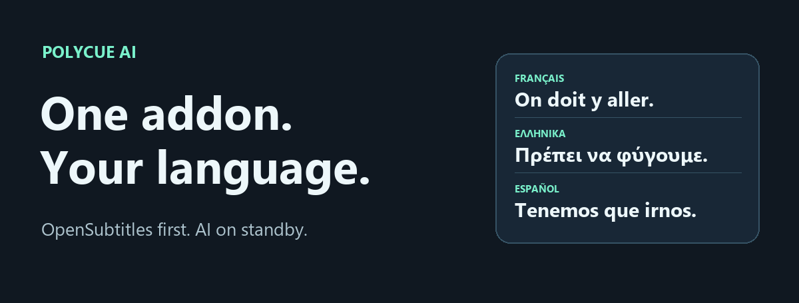
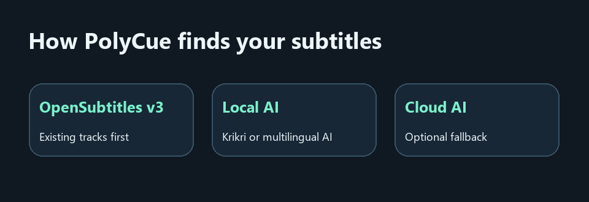

# PolyCue AI

**Stop juggling subtitle addons. Pick your language once.**

PolyCue AI gives Stremio a single subtitle addon with **OpenSubtitles v3 built in** and AI translation ready when the supplied track is missing or out of sync. Choose French, Greek, Spanish, Japanese, or another language during setup.

[**Install PolyCue AI →**](INSTALL.md) · [**Get the installer build →**](https://github.com/jfle/aio-streams-subtitles-greek/actions/workflows/ci.yml?query=branch%3Apolycue-ai)

## One install. Three ways to get the track.

1. **OpenSubtitles v3 first.** PolyCue lists the available tracks in your selected language. A separate OpenSubtitles addon is optional.
2. **Local Krikri next.** If you configure Llama-Krikri-8B-Instruct, PolyCue tries it first for AI translation, with thinking off. Local inference uses no cloud quota. [Download the official Q4_K_M GGUF (5.04 GB)](https://huggingface.co/ilsp/Llama-Krikri-8B-Instruct-GGUF/resolve/main/llama-krikri-8b-instruct-q4_k_m.gguf?download=true).
3. **Cloud when needed.** Set a cloud API provider to take over when the local model is unavailable or fails. If OpenSubtitles has a track, the AI backup waits until your player loads it.

**Built for real releases.** PolyCue checks the English source against the video release, can correct supported timing issues, and caches finished translations for rewatching.

**Start with OpenSubtitles alone.** It needs no AI account. Translation requires a usable English subtitle file, and language coverage and quality depend on the source and model. Krikri is tuned for Greek. For other languages, compare the test translation with your chosen cloud model.

PolyCue AI is an independent, MIT-licensed Stremio addon. Cloud providers may charge for usage. The [AIOStreams standalone install](https://github.com/jfle/aio-streams-subtitles-greek/tree/aiostreams-standalone) lives on its own branch.
